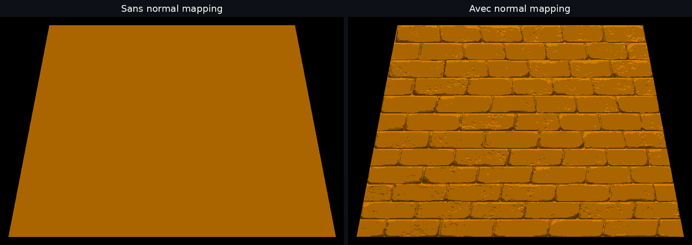
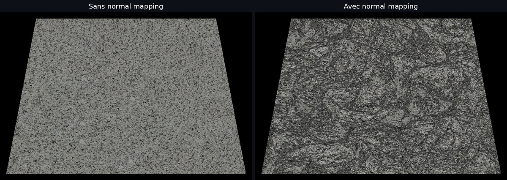
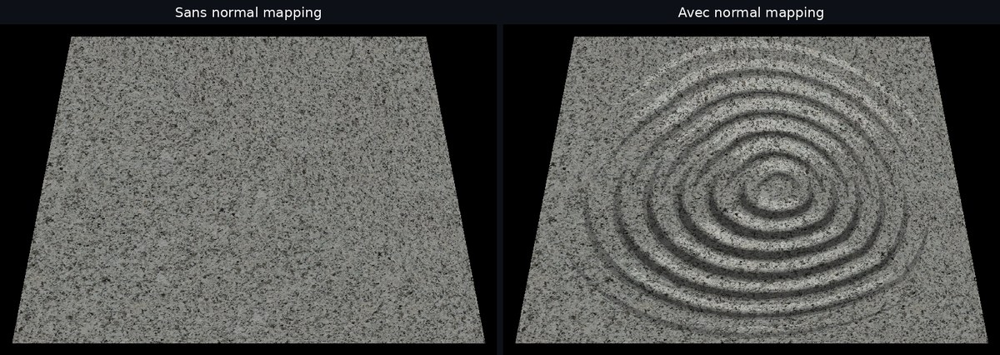

# Normal Mapping in a Software Rasterizer

A 3D rendering pipeline written from scratch in Python and NumPy (no OpenGL, no GPU), extended with **tangent-space normal mapping**: fine surface detail such as stone, bricks or engraved rings appears on a perfectly flat mesh made of only two triangles.



## Results

Same geometry (2 triangles), same color texture, same light. Only the normal map changes.





## How it works

The pipeline reproduces the stages of a GPU in plain Python:

1. **Vertex shader**: transforms each vertex with the view and projection matrices, and passes the normal, UV coordinates, tangent, view and light directions to the next stage.
2. **Rasterizer**: finds the pixels covered by each triangle using edge functions, and interpolates vertex data with barycentric coordinates.
3. **Depth test**: a z-buffer keeps the closest fragment. The test runs before shading, so hidden fragments are never shaded.
4. **Fragment shader**: Phong lighting (ambient, diffuse, specular) with a cel-shading quantization, multiplied by the color texture.

### Normal mapping

A normal map stores one normal per texel, encoded as RGB in tangent space (a local frame attached to the surface). To use it for lighting:

1. **Tangent computation** (`ComputeTangent`): for each triangle, the tangent **T** is derived from the edges of the triangle and their UV differences. Tangents are accumulated per vertex, then orthogonalized against the normal (Gram-Schmidt). Degenerate UVs fall back to an arbitrary perpendicular vector.
2. **TBN matrix** (fragment shader): after interpolation, **T** is re-orthogonalized against **N**, the bitangent is rebuilt as **B = N × T**, and the matrix `[T B N]` converts tangent space to world space.
3. **Decoding**: the sampled color is mapped from `[0, 1]` to `[-1, 1]` (`n = rgb × 2 − 1`), transformed by the TBN matrix, normalized, and used in the Phong computation instead of the geometric normal.

## Usage

```bash
pip install -r requirements.txt

# Default scene: stone texture with its normal map, opens a window
python main.py

# Same scene without normal mapping, for comparison
python main.py --no-normal-map

# Any combination of mesh, color texture and normal map, saved to a file
python main.py --scene Scenes/flat_big.ply \
               --texture ColorMap/orange.png \
               --normal-map NormalMap/wall_normal.png \
               --output wall.png
```

| Option | Default | Description |
| --- | --- | --- |
| `--scene` | `Scenes/flat_big.ply` | ASCII PLY mesh with `x y z nx ny nz s t` per vertex |
| `--texture` | `ColorMap/stone.png` | Color texture |
| `--normal-map` | `NormalMap/stone_NormalMap.png` | Tangent-space normal map |
| `--no-normal-map` | off | Replace the normal map with a flat one `(0, 0, 1)` |
| `--width`, `--height` | `1280`, `720` | Output resolution |
| `--output` | none | Save to a PNG instead of opening a window |

A 1280×720 frame of the flat scene renders in about 15 seconds: every pixel goes through Python code, which is the point of the exercise, not speed.

## Project structure

```
├── main.py              # Entry point: scene setup, command-line options
├── graphicPipeline.py   # Tangents, vertex shader, rasterizer, fragment shader, z-buffer
├── camera.py            # View matrix
├── projection.py        # Perspective projection matrix
├── readply.py           # ASCII PLY loader
├── Scenes/              # Meshes (.ply)
├── ColorMap/            # Color textures
├── NormalMap/           # Normal maps
├── images/              # Comparison renders
└── docs/poster.pdf      # Project poster (French)
```

## Limitations

- **Silhouettes stay flat**: normal mapping only changes lighting, not geometry. At grazing angles the surface looks flat again and there is no self-occlusion. *Displacement mapping* solves this by moving the vertices.
- **Large perturbations**: the illusion works best for small details. *Parallax occlusion mapping* gives a better result for deep relief.
- **Mirrored UVs**: the bitangent is rebuilt as `N × T` without a handedness sign, so meshes with mirrored UV islands would get inverted relief on one side.

## Context

Team project (3 students), computer graphics course at Grenoble INP - Ensimag, spring 2026. The base rasterization pipeline was built during the course lab sessions; this project extends it with normal mapping.

## References

- J. F. Blinn, [*Simulation of Wrinkled Surfaces*](https://dl.acm.org/doi/10.1145/965139.507101), SIGGRAPH 1978
- [LearnOpenGL: Normal Mapping](https://learnopengl.com/Advanced-Lighting/Normal-Mapping)
